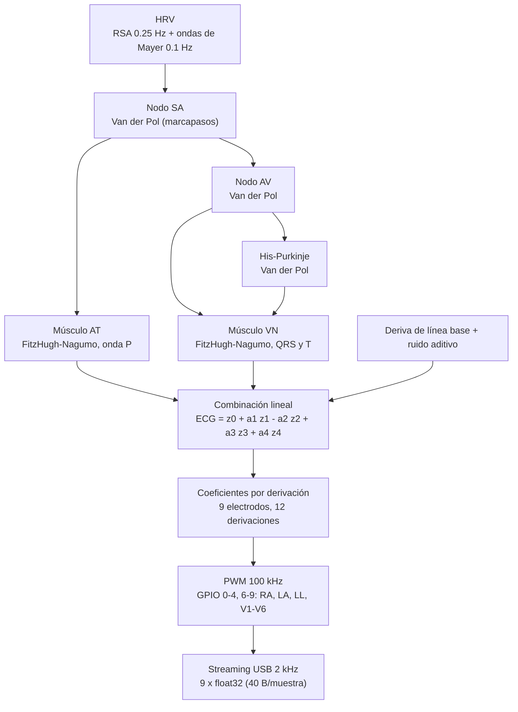

# 02 Pico Conduction Model (RP2350)

Simulador de ECG basado en el modelo de conducción cardiaca de osciladores heterogéneos acoplados, implementado en Raspberry Pi Pico 2 (RP2350). Genera las 12 derivaciones estándar de ECG en tiempo real.

**Paper de referencia:** Quiroz-Juarez et al., *"Cardiac Conduction Model for Generating 12 Lead ECG Signals With Realistic Heart Rate Dynamics"*, IEEE Trans. Nanobioscience, Vol. 17, No. 4, 2018.

## Modelo Matemático

El modelo consiste en dos subsistemas acoplados:

### Osciladores de Frenado de Van der Pol (Nodos Naturales)
Tres nodos marcapasos (SA, AV, HP) descritos por ecuaciones diferenciales de Van der Pol modificadas con acoplamiento retardado:

$$\ddot{x}_i = -a_i(x_i^2 - u)\dot{x}_i - f_i x_i(x_i + d)(x_i + e_i) + K_{node}(\dot{y}_{\tau} - \dot{y}_i)$$

### Osciladores de FitzHugh-Nagumo (Músculos AT/VN)
Cuatro osciladores que modelan la despolarización/repolarización de las aurículas y ventrículos (P, Ta, QRS, T):

$$k_j[-c_j z_j(z_j - w_{j1})(z_j - w_{j2}) - b_j v_j - g_j v_j z_j + I_j]$$

### Combinación de Derivaciones
La señal ECG de cada derivación se obtiene por combinación lineal ponderada:

$$ECG = z_0 + \alpha_1 z_1 - \alpha_2 z_2 + \alpha_3 z_3 + \alpha_4 z_4$$

Los coeficientes $\alpha_i$ se ajustan para cada una de las 12 derivaciones estándar.

## Diagrama de Flujo del Modelo



## Modelos Fisiológicos Adicionales

- **Variabilidad de la Frecuencia Cardíaca (HRV):** Modulación de la frecuencia del nodo SA con componentes RSA (0.25 Hz) y ondas de Mayer (0.1 Hz).
- **Deriva de Línea Base:** Oscilación sinusoidal acoplada a la frecuencia respiratoria.
- **Ruido Aditivo:** Distribución normal para simular incertidumbre de observación.

## Ritmos Cardíacos Soportados

| Ritmo | Descripción |
|:------|:-----------|
| Normal Sinusal | Ritmo cardíaco regular a frecuencia configurable |
| Bradicardia Sinusal | Frecuencia < 60 BPM |
| Taquicardia Sinusal | Frecuencia > 100 BPM |
| Bloqueo SA-AV | Desacople entre nodo SA y nodo AV (K_SA-AV = 0) |
| Bloqueo AV-HP | Desacople entre nodo AV y sistema His-Purkinje (K_AV-HP = 0) |
| Wellens V1-V3 | Síndrome de Wellens Tipo 1, isquemia (inversión de onda T en V1-V3) |

## Características del Firmware

- **9 Salidas PWM** (pins 0-4, 6-9): RA(ref), LA(=I), LL(=II), V1-V6 a 100 kHz
- **Integración del Modelo:** 2000 Hz en Core 1
- **Muestreo del Modelo:** 2000 Hz en Core 1
- **Interfaz de Usuario:** Menú GEM con encoder rotativo + pantalla OLED (SH1106/SSD1306)
- **Terminal Serial:** Menú interactivo espejo vía USB (115200 baudios)
- **Indicación de Latido:** LED + Buzzer sincronizados con el pico R
- **Formas de Onda de Calibración:** Seno, Triángulo, Cuadrada, Pulso

## Hardware y Pines

| Periférico | Pines | Notas |
|:-----------|:------|:------|
| **Salida PWM ECG** | 0, 1, 2, 3, 4, 6, 7, 8, 9 | RA, LA(I), LL(II), V1-V6 |
| **LED** | GPIO 5 | Indicación de Latido / Pico QRS |
| **Pico LED** | GPIO 25 | Indicación de comunicación USB |
| **Buzzer** | GPIO 15 | Feedback PWM / Indicación de Latido |
| **Encoder** | 20 (BTN), 21 (DATA), 22 (CLK) | Pull-up habilitado |
| **OLED (SPI0)** | 16 (DC), 17 (RST), 18 (SCK), 19 (MOSI) | SH1106 / SSD1306 |
| **Batería ADC** | GPIO 29 (ADC3) | Divisor de tensión 1/3 |
| **Calibración ADC** | GPIO 26 (ADC0) | Entrada desde la salida post-filtro de RA |
| **USB Sense** | GPIO 24 | Alto = USB conectado |

## Autocalibración al encender

Antes de iniciar el modelo en Core 1, el firmware emite temporalmente una
senoidal por RA (GPIO0) y mide la salida del filtro pasabajos con ADC0
(GPIO26). Luego simula el modelo con amplitud nominal, descarta el transitorio
inicial y mide los extremos de LA, LL y V1–V6. Con ambas mediciones calcula
Offset y Cal Gain para encajar las señales en ADC 300..3100 (aprox.
0.24..2.50 V), con margen frente a la saturación del op-amp observada cerca de
2.8 V. RA se fija en cero antes de iniciar la salida normal.

Durante la generación ECG también se limita el valor PWM a ese margen. Si la
calibración no tiene una lectura ADC válida, el firmware informa el fallo y
mantiene el offset automático ECG=0 y Cal Gain=1. El offset automático solo
afecta al ECG; `set offset` sigue siendo el ajuste manual existente, compartido
por el ECG y las formas de onda de prueba.

Conectar la salida del pasabajos de RA a GPIO26, con masa común, antes de
encender para calibrar. La entrada ADC debe permanecer entre 0 y 3.3 V. El
resultado se informa por USB y se consulta con `> get`.

## Parámetros Editables en Tiempo Real

Desde el menú OLED/terminal se pueden ajustar:

- **Frecuencia cardíaca** (BPM) - modifica la frecuencia del nodo SA
- **Profundidad HRV** - amplitud de la modulación respiratoria
- **Campos del modelo VdP** (a1-a3, f2-f3, u, d, e1-e3)
- **Coeficientes de ponderación** (alpha1-alpha4 por derivación)
- **Parámetros FitzHugh-Nagumo** (k, c, w, b, g, h por oscilador)
- **Deriva de línea base** (amplitud y frecuencia)
- **Habilitar/deshabilitar** HRV y deriva de línea base

## Estructura del Proyecto

```
02_pico_conduction_model/
├── CMakeLists.txt              # Build configuration (Pico SDK 2.x)
├── pico_ecg.c                  # Punto de entrada (Core 0: UI, Core 1: generación)
├── pico_sdk_import.cmake
├── Drivers/
│   ├── inc/
│   │   ├── cardiac_model.h     # Modelo de conducción cardiaca
│   │   ├── signal_gen.h        # Generador de señales PWM
│   │   ├── interface.h         # Display OLED + LED + buzzer
│   │   ├── menu.h              # Menú GEM
│   │   ├── cli.h               # Terminal serial
│   │   └── ...
│   └── src/
│       ├── cardiac_model.c     # Implementación del modelo VdP + FHN
│       ├── signal_gen.c        # Muestreo a 2kHz, mapeo a PWM
│       ├── interface.c
│       ├── menu.c
│       ├── cli.c
│       └── ...
└── ../common/                  # GEM y u8g2 compartidos por los firmwares
```

El `CMakeLists.txt` agrega `../common` y enlaza el target compartido `gem`,
que a su vez incorpora u8g2. No se mantienen copias locales de esas librerías.

## Estrategia de Generación de Electrodos

El generador excita directamente los potenciales de los electrodos:

- **V_RA = 0** (referencia)
- **V_LA = I** (derivación Lead I)
- **V_LL = II** (derivación Lead II)
- **V1-V6** se inyectan directamente desde el modelo

Las derivaciones resultantes se reconstruyen correctamente en el equipo receptor:
- I = V_LA - V_RA = I
- II = V_LL - V_RA = II
- III = V_LL - V_LA = II - I
- WCT = (V_RA + V_LA + V_LL) / 3

## Comandos CLI

El firmware expone una terminal CLI a través del puerto USB serial (115200 baudios). Todos los comandos deben llevar el prefijo `> `:

| Comando | Descripción |
|:--------|:------------|
| `> help` | Lista todos los comandos disponibles |
| `> info` | Muestra información del proyecto (usado por la GUI para auto-detectar) |
| `> get` | Muestra la configuración actual completa |
| `> set <param> <valor>` | Modifica un parámetro en tiempo real |
| `> set rhythm <n>` | Aplica el preset de ritmo n |
| `> set cal <gain>` | Ajusta la ganancia de calibración de salida |
| `> play` / `> stop` | Inicia / detiene la generación de señal |
| `> stream on` / `> stream off` | Activa / desactiva el streaming binario |
| `> ver` | Muestra versión del firmware |

### Parámetros de `set`

```
set type <ecg|sine|tri|sq|pulse>   # forma de onda de salida
set hr <bpm>                        # frecuencia cardíaca (15-250)
set amp <0-100>                     # amplitud (%)
set offset <n>                      # desplazamiento vertical (±16384)
set rhythm <n>                      # preset de ritmo cardíaco
set hrv <on|off>                    # variabilidad de frecuencia cardíaca
set hrvdepth <float>                # profundidad de la modulación HRV
set baseamp <mV>                    # amplitud de deriva de línea base
set basefreq <Hz>                   # frecuencia de la deriva
set a1 <v>  set a2 <v>              # alphas de P / Ta
set a3 <v>  set a4 <v>              # alphas de QRS / T
set delay <ms>                      # retardo del nodo
set buzzer <on|off>                 # buzzer
set led <on|off>                    # LED
set cal <gain>                      # ganancia de calibración de salida
```

## Streaming Binario y GUI en PC

El firmware soporta streaming binario de las 9 señales ECG a 2 kHz para visualización en PC:

- **Formato:** `0xAA 0x55` + 9 × `float32` (little-endian) + `0x55 0xAA` = **40 bytes/muestra**
- **Tasa:** ~80 KB/s a 2 kHz
- **Buffer circular:** 8192 muestras; Core 1 llena, Core 0 vacía vía USB

### Aplicación Python (`software/ecg_gui.py`)

La GUI Tkinter + matplotlib ofrece:

- Auto-conexión al puerto serial y detección del proyecto vía `> info`
- Sliders para parámetros del modelo (HR, alphas, delay, baseline, etc.)
- Selector de ritmos y controles de dispositivo (buzzer, LED, offset, HRV)
- Escala de amplitud y ventana de tiempo **fijas** (sin auto-escala)
- Slider de **Cal Gain** y botón **Get Settings** (sincroniza sliders con el firmware)
- Streaming con sincronización de trama robusta (sync de inicio y fin + validación)

Ejecutar desde `software/`: `python ecg_gui.py`  ·  Generar `.exe`:
`build_exe.bat`

## Calibración de Salida (Gain)

El modelo genera el ECG en **mV fisiológicos**. A la amplitud del generador se
le aplica Cal Gain y Offset antes de limitar la señal al rango PWM medido como
seguro:

```
nivel = 32768 + (mV_modelo × counts_per_mV) + offset
counts_per_mV = signal_amplitude × 2.5 × cal_gain
```

En el encendido se miden la transferencia PWM-filtro de RA y los extremos del
modelo a amplitud nominal; de esas medidas se obtienen Cal Gain y el offset
automático aplicado al ECG. La señal se limita además a los códigos PWM que
mantienen ADC0 dentro de 300..3100. La calibración requiere conectar la salida
filtrada de RA a GPIO26. Para verificar el Cal Gain y el offset manual, usar
`> get`; el Offset automático se informa en el mensaje de calibración al
arrancar. Para ajustar manualmente, usar `set cal <gain>` o `set offset <n>`.

En tiempo real:
```
> set cal 2.0        # ajusta la ganancia (rango 0.01..100)
> get                # muestra el offset manual y cal para sincronizar la GUI
```

Cal Gain y el offset automático se recalculan al reiniciar. El offset manual se
conserva en RAM mientras el equipo permanece encendido.

Al tener calibración válida, el streaming estima los mV a la salida del divisor
100 kΩ/1 kΩ a partir del valor PWM final, la transferencia ADC medida y el
divisor; transmite la excursión respecto del punto medio calibrado. Sin
calibración mantiene los mV originales del modelo.

## Instrucciones de Compilación

Requiere CMake y el SDK 2.x de la Raspberry Pi Pico.

```powershell
cmake -G Ninja -B build_shared -S .
ninja -C build_shared
```

El archivo `.uf2` resultante se flashea arrastrando al modo BOOTSEL.

## Parámetros por Defecto (Ritmo Normal)

| Parámetro | Valor | Descripción |
|:----------|:------|:-----------|
| a1 | 40 | Amortiguamiento nodo SA |
| a2, a3 | 50 | Amortiguamiento nodos AV, HP |
| f1 | 22 | Frecuencia SA (controlada por BPM) |
| f2 | 8.4 | Frecuencia AV intrínseca |
| f3 | 1.5 | Frecuencia HP intrínseca |
| u | 0.68 | Parámetro de forma del amortiguamiento |
| tau | 0.092 s | Retardo de acoplamiento entre nodos |
| k1 | 2000 | Escala temporal onda P |
| k3 | 10000 | Escala temporal QRS |
| C1..C4 | ~10^-5 | Coeficientes de acoplamiento músculo |
