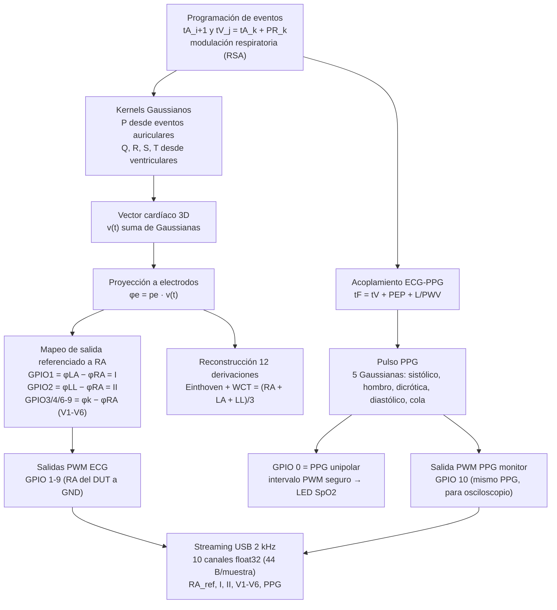

# Pico ECG-PPG - Gaussian Event-Driven Model (RP2350)

Simulador de señales ECG y PPG basado en un modelo evento-driven con kernels Gaussianos, implementado en Raspberry Pi Pico 2 (RP2350). Genera salidas ECG referenciadas a RA (GPIO1 = I, GPIO2 = II, GPIO3/4/6-9 = V1-V6) + 2 canales PPG (GPIO0 para LED SpO2, GPIO10 para monitor) sincronizados en tiempo real. La GUI muestra RA=0, LA-RA/LL-RA y V1-V6 con referencia a WCT para preservar la morfología esperada.

**Paper de referencia:** Huynh, Tran & Tran, *"An ECG-PPG Physiological Signal Emulator for Calibration and Validation of Cardiovascular Monitoring Devices"*, Sensors 2026, 26, 5578.

## Modelo Matemático

### Programación de Eventos (Ecuaciones 1-2)
La actividad auricular y ventricular se modela como secuencias de eventos independientes con modulación respiratoria:

$$t_{i+1}^q = t_i^q + \frac{60}{HR_q} [1 + \alpha_q \sin(2\pi f_r t_i^q)]$$

La conducción AV se representa con una variable binaria $c_k$ y un intervalo PR por evento:

$$t_j^V = t_k^A + PR_k, \quad c_k = 1$$

### ECG Multiderivación (Ecuaciones 3-6)
El vector cardíaco 3D `v(t) = [X, Y, Z]` se construye como suma de Gaussianas. Cada onda (P, Q, R, S, T) tiene una dirección unitaria `e_m` y una amplitud escalar `a_m`; los eventos auriculares disparan P y los ventriculares disparan Q, R, S, T:

$$v(t) = \sum_k a_P e_P \exp\left(-\frac{(t-t_k^A-\mu_P)^2}{2\sigma_P^2}\right) + \sum_j \sum_m a_{m,c_j} e_{m,c_j} \exp\left(-\frac{(t-t_j^V-\mu_{m,c_j})^2}{2\sigma_{m,c_j}^2}\right)$$

Cada electrodo se obtiene por proyección del vector cardíaco (ec. 4): $\phi_e(t) = p_e \cdot v(t)$, y las 12 derivaciones se reconstruyen con las fórmulas de Einthoven y el terminal central de Wilson (ec. 6).

### Acoplamiento ECG-PPG (Ecuaciones 7-8)
El pulso periférico se genera a partir de la activación ventricular con un retardo electromecánico:

$$t_{F,j} = t_j^V + PEP_j + \frac{L}{PWV_j}$$

Cada pulso PPG se compone de 5 Gaussianas (pico sistólico, hombro, muesca dicrótica, pico diastólico, cola).

### Adaptación de la Onda T al Ritmo (Ecuación 5)
La posición y anchura de la onda T se escalan según el intervalo RR:

$$f_{T,j} = \text{clip}\left(\left(\frac{RR_j}{RR_0}\right)^{\alpha_{QT}}, f_{min}, f_{max}\right)$$

## Diagrama de Flujo del Modelo



## Ritmos Cardíacos Soportados

| Ritmo | Descripción |
|:------|:-----------|
| Normal Sinusal | Ritmo regular, conducción 1:1, PR = 160 ms |
| Bloqueo AV de 1er Grado | Conducción 1:1 con PR prolongado (240 ms) |
| Mobitz I (Wenckebach) | PR0 = 160 ms, +40 ms por latido conducido, luego latido bloqueado y reinicio |
| Bloqueo AV Completo | Disociación AV: aurículas 75 BPM, ritmo de escape ventricular 38 BPM |
| Taquicardia Auricular | Frecuencia auricular 160 BPM con protección refractaria AV (respuesta 2:1) |
| Taquicardia Ventricular | Ritmo ectópico ventricular 160 BPM, QRS ensanchado y despolarizado |

## Diferencias con el Modelo Base (pico_ecg)

| Característica | pico_ecg (base) | Este proyecto (Gaussian PPG) |
|:---------------|:----------------|:----------------------------|
| Modelo ECG | Datos tabulados en .h | Generativo: 5 Gaussianas por evento |
| PPG | No disponible | Sí, 5-Gaussianas sincronizadas con ventrículo |
| Salidas PWM | 9 (ECG) | 10 (8 ECG referenciados a RA + GPIO0 como PPG SpO2 + GPIO10 PPG monitor) |
| Referencia ECG | RA se emite como potencial de electrodo | RA va a GND; las demás salidas son potenciales **referenciados a RA** (GPIO1 = I, GPIO2 = II) para que el DUT mida las 12 derivaciones exactas |
| Arritmias | Sin soporte | 6 ritmos con bloqueos AV |
| Conducción AV | No modelada | Evento-drivada con PR variable |
| Muestreo | 2 kHz | 2 kHz |

## Hardware y Pines

| Periférico | Pines | Notas |
|:-----------|:------|:------|
| **Salida PWM ECG** | 1, 2, 3, 4, 6, 7, 8, 9 | Potenciales **referenciados a RA**: GPIO1 = φLA − φRA = **derivación I**, GPIO2 = φLL − φRA = **derivación II**, GPIO3/4/6-9 = φVk − φRA (V1-V6). **No se usa el terminal RA como salida; debe conectarse a GND. Usar RL como referencia común / 0V.** |
| **Salida PPG → LED SpO2** | **GPIO 0** | Emite PPG unipolar dentro del intervalo PWM seguro medido durante la autocalibración. |
| **LED** | GPIO 5 | Indicación de Latido / Pico QRS |
| **Pico LED** | GPIO 25 | Indicación de comunicación USB |
| **Buzzer** | GPIO 15 | Feedback PWM / Indicación de Latido |
| **Encoder** | 20 (BTN), 21 (DATA), 22 (CLK) | Pull-up habilitado |
| **OLED (SPI0)** | 16 (DC), 17 (RST), 18 (SCK), 19 (MOSI) | SH1106 / SSD1306 |
| **Batería ADC** | GPIO 29 (ADC3) | Divisor de tensión 1/3 |
| **Calibración ADC** | GPIO 26 (ADC0) | Entrada desde la salida post-filtro de GPIO1 (derivación I) |
| **USB Sense** | GPIO 24 | Alto = USB conectado |

> **Nota hardware:** Este proyecto utiliza el **pin GPIO 10** como salida PPG adicional de monitorización, que no existe en el proyecto base pico_ecg.

### Por qué las salidas están referenciadas a RA

El potencial φ_RA no se emite en ningún pin (GPIO0 es la PPG), por lo que el
RA del dispositivo bajo prueba (DUT) se conecta a GND. Con el RA a 0 V, el
terminal central de Wilson del DUT vale `(0 + I + II)/3`; como las salidas ya
llevan φ_LA − φ_RA y φ_LL − φ_RA, ese WCT da exactamente **−φ_RA** (el WCT del
modelo es 0 porque los vectores de proyección de las extremidades suman cero),
y cada precordial del DUT queda `(φ_k − φ_RA) − (−φ_RA) = φ_k`, que es la
derivación del modelo. Resultado: **el DUT mide las 12 derivaciones del paper
sin error alguno** (I, II y III/aVR/aVL/aVF directas; V1–V6 exactas). El
firmware verifica esta propiedad en `gaussian_model_self_test()`
(chequeo `OUT`).

## Autocalibración al encender

Antes de iniciar el modelo en Core 1, el firmware emite temporalmente una
senoidal por GPIO1 (derivación I) y mide la salida del filtro pasabajos
con ADC0 (GPIO26). Se calibra esta salida ECG bipolar; GPIO0 permanece
reservado para la PPG unipolar. Luego simula el modelo gaussiano con amplitud nominal,
descarta el transitorio inicial y mide los extremos **de las 8 salidas ECG
referenciadas a RA** (GPIO1-9: I, II, V1–V6; el canal RA de referencia no se
emite en ningún pin). Con ambas mediciones calcula Offset y Cal Gain para
encajar las señales en ADC 300..3100 (aprox. 0.24..2.50 V), con margen frente
a la saturación del op-amp.

Durante la generación ECG también se limita el valor PWM a ese margen. Si la
calibración no tiene una lectura ADC válida, el firmware informa el fallo y
mantiene el offset automático ECG=0 y Cal Gain=1. El offset automático solo
afecta al ECG; `set offset` sigue siendo el ajuste manual existente, compartido
por el ECG y las formas de onda de prueba. GPIO0 y GPIO10 emiten la misma PPG,
mapeada dentro de la ventana PWM segura medida en la calibración; la escala
PPG es 80% por defecto.

Conectar la salida del pasabajos de GPIO1 (derivación I) a GPIO26, con masa
común, antes de encender para calibrar. Durante el arranque GPIO1 emite la
senoidal de calibración y luego vuelve al ECG. La entrada ADC debe permanecer
entre 0 y 3.3 V. El resultado se informa por USB y se consulta con `> get`.

## Parámetros Editables en Tiempo Real

### Event Schedule
- **Frecuencia auricular** (BPM) - tasa base de eventos
- **Profundidad modulación respiratoria** - amplitud del RSA
- **Frecuencia respiratoria** (Hz)

### Conducción AV
- **Intervalo PR base** (ms) - latencia AV normal
- **Incremento PR Mobitz I** (ms) - prolongación por latido
- **Latidos antes de bloqueo** - ciclos de Wenckebach
- **Frecuencia de escape** (BPM) - ritmo ventricular independiente

### Forma de Onda ECG (Gaussianas)
- **Amplitud/posición/anchura** de cada componente: P, Q, R, S, T
- **Exponente QT** y escalado rate-dependent de la onda T

### Acoplamiento PPG
- **Pre-ejection period** (ms)
- **Longitud vascular** (m) y **velocidad de onda de pulso** (m/s)
- **Escala de amplitud ectópica** - reducción del pulso en latidos ventriculares

### Parámetros de Onda PPG
Los 5 componentes Gaussianos del pulso periférico son fijos (documentados en el código):
1. Pico sistólico (120 ms, sigma 45 ms)
2. Hombro sistólico (180 ms, sigma 50 ms)
3. Región de muesca dicrótica (300 ms, sigma 60 ms)
4. Pico diastólico (400 ms, sigma 80 ms)
5. Cola (550 ms, sigma 100 ms)

## Estrategia de Generación de Electrodos

Fiel al paper (ec. 3-4 y 6), el ECG se genera en tres pasos, más un cuarto
paso de mapeo a hardware:

1. **Vector cardíaco 3D** `v(t) = [X, Y, Z]`: suma de Gaussianas por onda (P desde los eventos auriculares; Q, R, S, T desde los ventriculares). Cada componente tiene una dirección unitaria fija `e_m` y amplitud escalar editable `a_m` (`vamp` de P/Q/R/S/T).
2. **Proyección a electrodos** `φ_e = p_e · v(t)`: cada electrodo tiene un vector de proyección `p_e` (dirección unidad desde el dipolo cardíaco). Los electrodos de extremidades forman un triángulo de Einthoven cerrado con `p_RA + p_LA + p_LL = 0`, de modo que RA, LA, LL ya no son ganancias heurísticas (el WCT del modelo es 0).
3. **Reconstrucción de 12 derivaciones** desde los 9 electrodos (índices 0..8 = RA, LA, LL, V1..V6), con el terminal central de Wilson `WCT = (RA + LA + LL)/3`:
   - I = LA − RA, II = LL − RA, III = LL − LA
   - aVR = RA − (LA+LL)/2, aVL = LA − (RA+LL)/2, aVF = LL − (RA+LA)/2
   - V1..V6 = electrodo − WCT

   La función `gaussian_model_compute_12_leads(el[9], leads[12])` realiza esta reconstrucción, y `gaussian_model_get_einthoven_error()` reporta las comprobaciones en vivo (`III − (II − I) ≈ 0` y `aVR + aVL + aVF ≈ 0`, del orden de 1e-15 en coma flotante).
4. **Mapeo a los pines** `gaussian_model_compute_output_electrodes(el[9], out[9])`: como GPIO0 es la PPG y el RA del DUT va a GND, cada pin ECG emite el potencial **referenciado a RA**:
   - `out[0] = φ_RA` (referencia; solo va por streaming, no por pin)
   - `out[1] = φ_LA − φ_RA = I` → GPIO1
   - `out[2] = φ_LL − φ_RA = II` → GPIO2
   - `out[3..8] = φ_Vk − φ_RA` → GPIO3..9

   Con el RA del DUT a 0 V su WCT vale `(0 + I + II)/3 = −φ_RA`, así que sus
   precordiales quedan `(φ_k − φ_RA) − (−φ_RA) = φ_k`: el DUT mide las 12
   derivaciones del modelo exactamente. `gaussian_model_self_test()` valida este
   mapeo (chequeo `OUT`) además de PR/RR y Einthoven/Wilson.

## Estructura del Proyecto

```
03_pico_ecg_gaussian_ppg/
├── CMakeLists.txt               # Enlaza 'gem'/'u8g2' desde ../common
├── pico_ecg.c                   # Punto de entrada
├── pico_sdk_import.cmake
└── Drivers/
    ├── inc/
    │   ├── gaussian_ecg_ppg_model.h  # Modelo Gaussiano ECG+PPG
    │   ├── signal_gen.h              # Generador PWM (10 canales)
    │   └── ...
    └── src/
        ├── gaussian_ecg_ppg_model.c  # Eventos + Gaussianas + PPG
        ├── signal_gen.c              # Muestreo 2kHz, mapeo 10 PWM
        └── ...
```

GEM y u8g2 se comparten desde [firmware/common](../common); este módulo no
incorpora copias locales de esas librerías.

## Comandos CLI

El firmware expone una terminal CLI a través del puerto USB serial (115200 baudios). Todos los comandos deben llevar el prefijo `> `:

| Comando | Descripción |
|:--------|:------------|
| `> help` | Lista todos los comandos disponibles |
| `> info` | Muestra información del proyecto (usado por la GUI para auto-detectar) |
| `> get` | Muestra la configuración actual completa |
| `> set <param> <valor>` | Modifica un parámetro en tiempo real |
| `> set rhythm <n>` | Aplica el preset de ritmo n |
| `> set cal <gain>` | Ajusta la ganancia de calibración de salida |
| `> play` / `> stop` | Inicia / detiene la generación de señal |
| `> stream on` / `> stream off` | Activa / desactiva el streaming binario |
| `> ver` | Muestra versión del firmware |

### Parámetros de `set`

```
set type <ecg|sine|tri|sq|pulse>   # forma de onda de salida
set hr <bpm> set amp <0-100> set offset <n>
set rhythm <n>                      # preset de ritmo
set pr <ms> set princ <ms>          # intervalo PR base / incremento Mobitz I
set escape <bpm>                    # frecuencia de escape ventricular
set respdepth <v> set respfreq <Hz> # modulación respiratoria (RSA)
set qtexp <v>                       # exponente QT
set pamp <v> set pmu <ms> set psigma <ms>   # onda P
set qamp <v> set ramp <v> set samp <v>      # Q, R, S
set tamp <v> set tmu <ms> set tsigma <ms>   # onda T
set pep <ms> set len <m> set pwv <m/s>      # acoplamiento PPG
set ectamp <v> set ectwiden <v> set ectdelay <ms> set ectpep <ms>  # latidos ectópicos
set buzzer <on|off>  set led <on|off>
set cal <gain>                      # ganancia de calibración de salida
```

## Streaming Binario y GUI en PC

El firmware soporta streaming binario de las 9 señales ECG + 1 canal PPG a 2 kHz para visualización en PC:

- **Formato:** `0xAA 0x55` + 10 × `float32` (little-endian) + `0x55 0xAA` = **44 bytes/muestra**
- **Canales:** `[0]` = potencial del electrodo RA del modelo (referencia; no se emite por pin), `[1..8]` = las salidas de pin referenciadas a RA (I, II, V1..V6) en mV-equivalentes, `[9]` = PPG en unidades arbitrarias (0..~1)
- **Tasa:** ~88 KB/s a 2 kHz
- **Buffer circular:** 8192 muestras; Core 1 llena, Core 0 vacía vía USB

> La GUI (`ecg_gui.py`) detecta el proyecto y ajusta el decodificador: para `pico_ecg_gaussian_ppg` espera frames de 10 canales, **reconstruye las 12 derivaciones** estándar a partir de `[0..8]` y muestra el PPG en un panel inferior; los demás proyectos siguen con 9 canales (sin panel PPG).

### Aplicación Python (`software/ecg_gui.py`)

La carpeta `software/` contiene una GUI Tkinter + matplotlib (común a los proyectos de simulación):

- Auto-conexión al puerto serial y detección del proyecto vía `> info`
- Sliders para parámetros del modelo gaussiano (HR, PR, amplitudes de ondas, RSA, etc.), con los **defaults del paper** (PR 160 ms, R 1.2, T 0.19, QTexp 0.3, RSA 0)
- Selector de ritmos y controles de dispositivo (buzzer, LED, offset, HRV)
- Escala de amplitud configurable, con **auto-escala activada por defecto**
- **12 derivaciones** (I, II, III, aVR, aVL, aVF, V1–V6) para el proyecto gaussiano: la GUI recompone el WCT igual que el DUT con RA a GND y muestra cada derivación reconstruida, no los potenciales de electrodo crudos
- **Panel PPG** en un subplot inferior, mostrado para el proyecto Gaussian ECG+PPG
- Slider de **Cal Gain** y botón **Get Settings** (sincroniza sliders con el firmware)
- Streaming con sincronización de trama robusta (sync de inicio y fin + validación)

Ejecutar: `python ecg_gui.py`  ·  Generar `.exe`: `build_exe.bat`

## Calibración de Salida (Gain)

El modelo genera amplitudes ECG en **mV fisiológicos**. La calibración y la
generación en tiempo real usan la misma conversión a niveles PWM:

```
nivel = 32768 + (mV_modelo × counts_per_mV × cal_gain) + offset
counts_per_mV = signal_amplitude × 2.5
```

El arranque mide el rango del modelo con `counts_per_mV` y calcula Cal Gain
para usar el rango ADC seguro 300..3100. Si se elevan manualmente la amplitud,
Cal Gain o las amplitudes de las ondas, la salida se limita a esa misma ventana
segura para proteger el op-amp; un aplanamiento en esos límites indica que la
señal solicitada excede el rango calibrado.

En el encendido se miden la transferencia PWM-filtro de GPIO1 y los extremos
del modelo gaussiano a amplitud nominal usando esa misma escala (ver
[Autocalibración al encender](#autocalibración-al-encender)); de esas medidas
se obtienen Cal Gain y el offset automático aplicado al ECG. La calibración
requiere conectar la salida filtrada de GPIO1 (derivación I) a GPIO26. Para
ajustar manualmente además del valor automático, usar `set cal <gain>` o
`set offset <n>`.

Procedimiento de calibración manual adicional:

1. Genere un ECG de referencia (amplitud del QRS del modelo ≈ 1 mV)
2. Mida el valor pico a pico real en el osciloscopio (`V_med`)
3. Ajuste el factor necesario: `cal = V_deseado / V_med` (ej. si `V_med = 150 mV` y quiere `300 mV` → `set cal 2.0`)

En tiempo real:
```
> set cal 2.0        # duplica la salida instantáneamente
> get                # muestra  cal = 2.000 (mV->counts multiplier)
```

Rango válido: 0.01 ... 100. El valor **no se guarda en flash** (solo RAM); Cal
Gain y el offset automático se recalculan al reiniciar.

## Instrucciones de Compilación

```powershell
mkdir build
cd build
cmake -G Ninja ..
ninja
```

## Valores por Defecto (Ritmo Normal, 72 BPM)

| Parámetro | Valor |
|:----------|:------|
| Frecuencia auricular | 72 BPM |
| Intervalo PR | 160 ms |
| Amplitud P | 1.2 |
| Posición P (mu, desde el evento auricular) | 45 ms |
| Amplitud R | 30.0 |
| Amplitud T | 0.75 |
| Ancho R (sigma) | 13.3 ms |
| Retardo T (mu) | 208.3 ms |
| Pre-ejection period | 80 ms |
| PPE extra ectópica | 20 ms |
| Velocidad onda pulso | 5.0 m/s |
| Longitud vascular | 0.5 m |

> **Convención de tiempos:** `mu_P ≥ 0` se mide desde el evento auricular `t_k^A`
> (pico P = `t_k^A + mu_P`), y el evento ventricular conducido hereda el intervalo
> medido: `t_j^V = t_k^A + PR_k`. Así el PR medido es exactamente `PR_k` ms y el
> pico P cae `PR − mu_P` ms antes de R (para los valores por defecto: 115 ms).
> No hay ningún desplazamiento implícito adicional.

## Autotest del Modelo (depuración)

El modelo lleva un autotest determinista (`gaussian_model_self_test()`) que
ejecuta 3 s de simulación por cada preset de ritmo y verifica contra los
valores del paper: PR medido, RR ventricular (NSR 833 ms, 1er grado 833 ms,
bloqueo completo 1579 ms, taquicardia auricular 750 ms — respuesta 2:1 —,
VT 375 ms) y las restricciones de Einthoven/Wilson. Para ejecutarlo al
arrancar e imprimir el resumen por USB-serial:

```powershell
cmake -G Ninja -B build_dev -DGAUSSIAN_MODEL_SELF_TEST_RUN_AT_BOOT=ON ..
ninja -C build_dev
```
